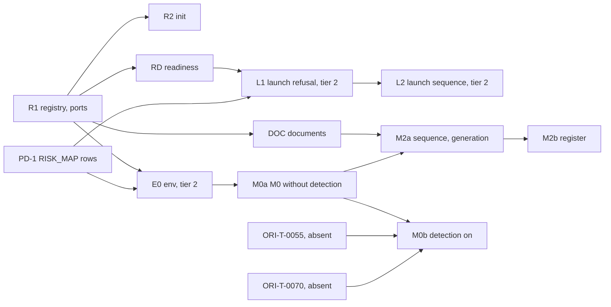

# Batch 12 plan (draft): `ori-flows` (ORI-T-0060 to ORI-T-0065)

> **Status: draft, not adopted.** Written by the planner (read-only, at `2ab7e63`), saved here by the lead on 2026-10-19 at the operator's request so it survives the session. Its review is `ops/batch-12-plan-review.md`. The lead has not adopted any decision below; the adopted plan will be `ops/batch-12-plan.md`.

This is the "before each batch" control point of `ops/phase-1-backlog.md` (:38-48). It is a draft written on 2026-10-19 by the synthesis planner. The planner only read the tree, at `2ab7e63` on `claude/sweet-maxwell-jkaiie`, which is 264 commits ahead of `origin/main`. Six independent per-ticket planning records were checked against each other and against the files. Every load-bearing claim below carries a file:line citation. Work integrated on the session branch counts as present. When something is present at HEAD but not on `origin/main`, the tables say so. Nothing in this draft is decided until the lead takes it.

## Preconditions at HEAD

The backlog's batch preconditions (`ops/phase-1-backlog.md:277`) are "Batches 2, 3, 6, 7, 8 merged", plus `templates/`, plus the fixture ordering conflict. The operator has answered the fixture conflict: "move them forward" (backlog:347).

| Precondition | At HEAD | Evidence | On `origin/main` |
|---|---|---|---|
| Batch 2, `ori-core` | present | `crates/ori-core/src/{types,error,ticket,document,phase,permission}.rs` | yes (document.rs, phase.rs checked) |
| Batch 3, `ori-store` | present | `db.rs`, `event_log.rs`, `projections/`, `rebuild.rs` | yes (event_log.rs checked) |
| Batch 6, `ori-memory` | present | ten modules. Among them `freshness.rs` (`is_ready` at :759), `drift.rs` (`run` at :592), `citation.rs`, `barrier.rs` (`sanitize_text` at :1896) | **`drift.rs` and `citation.rs` are not on main** |
| Batch 7, `ori-gates` | present except ORI-T-0047 and ORI-T-0048 | `crates/ori-gates/src` has no `citation_gate.rs` and no `diagram.rs`. ORI-T-0047 waits on the operator's HTML fix (backlog, batch 7 row and preconditions) | `prover.rs` and `liveness.rs` are not on main. No batch 12 slice uses 0047 or 0048 |
| Batch 8, `ori-orchestrator` | present | `lifecycle.rs`, `lock_table.rs`, `escalation.rs`, `budgets.rs`, `closing.rs`, `merge_queue.rs` | yes |
| `templates/` (ORI-T-0009) | present, ten forms | `templates/README.md:66`: the foundation-set and phase-set document templates are "not written by this batch". | yes. Needed only if `generate` stays in phase 1, which D9 defers |
| `fixtures/new-product` (ORI-T-0073) | present, `README.md` only, by design | `git ls-files`: 1 file. `fixtures/new-product/README.md:20-42` (derive the empty directory) | **no** |
| `fixtures/migrated-with-drift` (ORI-T-0074) | present, 21 files | `ops/lock-table.md:600` (claim 73 integrated) | **no** |
| `ori-memory` PM2, `sanitize_text` | present | `barrier.rs:1896` | — |
| `ori-mcp` S5, `SpecDesk` | present | `crates/ori-mcp/src/ports.rs:298`, `propose` at :327 | **no** (`ports.rs` is not on main) |
| `serde` / `serde_json` approval | answered | `ops/escalations/E-0008-json-serialization.md:32`: "Approved: `serde` and `serde_json`, pinned, workspace-wide." | — |
| ORI-T-0060 (registry, init) | **absent** | `crates/ori-flows/src` holds only `lib.rs` (a 6-line doc header). `git log -- crates/ori-flows` shows only `ecbb71c` and `7bed207` | — |
| Batch 9, ORI-T-0055 (attribution) | **absent** | `crates/ori-watch/src` = `hooks.rs`, `lib.rs`, `watcher.rs`. It waits on ORI-T-0163, claim 112, held with the operator (`ops/lock-table.md:2113`, tail) | not listed in backlog:277 |
| ORI-T-0029 (`forbidden.rs`) | **absent** | `crates/ori-broker/src/lib.rs:19-20`. Unblocked at `ops/lock-table.md:446` | — |
| ORI-T-0059 (VCS adapter) | **absent** | `crates/ori-integrations/src/lib.rs` is 9 lines. The only `impl VcsHost` are test fakes, `crates/ori-core/src/adapters.rs:1811, :2021` | — |
| ORI-T-0066/0068 (`ori-rpc`), ORI-T-0070 (`ori-engine`), ORI-T-0071 (`ori-cli`) | **absent** | `ori-rpc/src/lib.rs` 8 lines, `ori-engine/src/lib.rs` 12 lines, `ori-cli/src/main.rs` 26 lines | — |
| Lock-table claims on `ori-flows` | none | The only `ori-flows` mention is the ORI-T-0061 constraint at `ops/lock-table.md:344`. Held claims are 20, 112 and 117. The next free identifier is ORI-T-0194 (tail) | — |

## Decisions for the lead

| # | Decision | Reason |
|---|---|---|
| D1 | **One registry, one fold, one writer, owned by ORI-T-0060** in a new `crates/ori-flows/src/registry.rs`. This widens the backlog row's `init.rs` (backlog:268). Its contents: (1) `FOUNDATION`, the eleven AICD §23 G1 documents (methodology html:880), each with kind, path and one owner seat (D12). (2) `RegisteredDocument { document, owner: Seat }`. (3) `DocumentRegistry::read`, which verifies the log and folds it, calling `Document::apply` (document.rs:362) for every `document.*` transition. (4) `registry::record`, the only code path that appends a `document.*` event. It refuses what `Document::apply` refuses and any move `DocumentEvent::fires_from` (document.rs:312) is false for, appends through `EventLog::append` (event_log.rs:701), and returns the seq. Every other ticket consumes these and none folds `document.*` itself | Three records would otherwise each fold the log and each define payloads: ORI-T-0063's "Duplicate folds" risk, ORI-T-0065's "Vocabulary collisions" risk, and ORI-T-0061's request for one foundation constant. Events are immutable, so the payload shape is fixed forever by whoever writes first. `document.rs:130` puts offering a move on `ori-flows`. RISK_MAP:21 tiers the crate 1 on the ground "Approvals are events checked in core", which holds only if no second path appends approvals |
| D2 | **The `document.*` and `product.created` payloads, fixed now and written once in `registry.rs`.**  • `product.created` (one event at init, human actor, no ticket): `{name, repo_path, repo_remote, aicd_version, origin:"new", seats:[{seat, holder}], documents:[{id, kind, path, set:"foundation", owner}]}`.  • `document.registered`, for any document registered after init (M2's as-built slots, later phase sets): `{document_id, kind, path, set, owner}`. It is a registry event for the birth edge `[*] --> Missing`, not a core transition.  • `document.created`: `{document_id, pr?, content_len?, citations_unresolved?}`.  • `document.revised`, a `spec.write` on a Draft with no state change: `{document_id, pr, content_len, citations_unresolved}`.  • `document.submitted` and `document.drifted`: `{document_id}`.  • `document.changes_requested`: `{document_id, instructions}`, human text, length-capped.  • `document.approved`: `{document_id, seat}`, where the actor must be `Actor::Human`.  Kind strings come from `DocumentEvent::as_str` (document.rs:275) where a variant exists. The fold refuses unknown and duplicate keys. Content never goes into an event | ORI-T-0060's fold refuses unknown fields. ORI-T-0063 needs `pr` and `content_len` on `document.created`, and ORI-T-0065 needs registration fields, so all of them must be in the schema from the start, or 0063 and 0065 would have to edit `registry.rs`, a file they do not own. A single `product.created` keeps ORI-P1-028's "one event" per mutating call (criteria:34) and API_SPEC:10's single returned seq. `spec.write` on a Draft must produce an event (API_SPEC:10), and no `DocumentEvent` applies Draft to Draft (TRANSITIONS, document.rs:118). Agent text stays out of events (SECURITY_NOTES:51; batch 10 D4, `ops/batch-10-plan.md:12`) |
| D3 | **The other new event kinds, named now** (the batch 10 D4 precedent):  • `launch.refused`, `launch.completed` and `launch.failed {step, section}`;  • `migration.freeze_declared`, `migration.baseline_tagged`, `migration.detection_enabled`, `migration.inventory_recorded` and `migration.env_report_recorded`;  • `divergence.filed` and `divergence.resolved`.  A documentation ticket adds them, with `product.created` and the derived `document.*` kinds, to API_SPEC §2 (PD-2) | API_SPEC:93 lists none of them, though its list reads "Kinds include". M0 does not drive a Phase entity (Q3). Projectors route by kind prefix (`crates/ori-store/src/projections/ticket.rs:213`), so `phase.*` is left to the Phase entity and its future projection. ORI-T-0064 proposed `phase.*` and, if the Phase machine is not driven, `phase.freeze_declared`; it raised the conflict itself (its Q3) |
| D4 | **Crate edges.** Add `ori-flows -> ori-core` (LLD:87), `serde` and `serde_json` pinned as `crates/ori-store/Cargo.toml` pins them (E-0008:32), and `ori-flows -> ori-memory`. Add no edge to `ori-broker`, `ori-gates`, `ori-runtime`, `ori-watch`, `ori-mcp` or `ori-integrations` | LLD:42 allows "those below it". LLD:87 already reads "below" transitively for `ori-core`, which "the graph does not draw separately". `ori-memory` is below `ori-flows` through FLOWS→ORC (LLD:55) and ORC→MEM (LLD:60). Its freshness, drift, citation and barrier functions are pure library calls with no controlled caller. It is the first undrawn non-core edge (every manifest's other workspace edges are drawn; checked), so PD-2 draws it. Broker, gates prover, runtime and merge are excluded because of the controlled-caller facts in CLAUDE.md:32 (only the broker issues, only the runtime spawns, only `merge_queue` merges), not because of LLD. Watch, mcp and integrations are sideways (LLD:50-52) |
| D5 | **Ports.** A new `crates/ori-flows/src/ports.rs`, created by slice R1, holds only the shared items: `IdSource` (the shape of `ori_mcp::ports::IdSource`, ports.rs:235) and `PortError` (Refused carries a `MethodologyRef`; Invalid and Unavailable carry none). Module-specific port traits live in their own module (`init.rs`, `launch.rs`, `documents.rs`, `migrate/m0.rs`), and `ori-engine` implements all of them (ENG→FLOWS, LLD:49). Every port that writes takes `&mut ProductDb` (LLD:110). No port carries a credential value. PD-2 gives LLD:74's row a "Ports" clause, as LLD:76 and :89 do for `ori-mcp` | The precedent is batch 10 D1 (`ops/batch-10-plan.md:9`). `ori-flows` cannot reach `ori-mcp`'s `IdSource`, because that edge would be sideways. Without D5, four records declare four `IdSource`s (0060 in `init.rs`, 0062 in `launch.rs`, 0065 a closure, 0063 and 0064 each a `ports.rs` of their own) |
| D6 | **The working tree.** Init and M0 read the product directory only through ports the engine implements: init's emptiness check through a tree-probe port declared in `init.rs`, and M0 through `RepositoryView`. Init itself creates only the skeleton directories, with `fs::create_dir`, never `create_dir_all` | CLAUDE.md:32 (a load-bearing fact, "do not infer otherwise") and ARCHITECTURE:130 say only the watch component reads the working tree outside a session. The precedent is "The prover reads no file" (prover.rs:48). This settles the conflict between ORI-T-0060, which proposed a lead ruling that the rule does not cover a directory that is not yet a product, and ORI-T-0064, which proposed ports. Both directions sit on the same rule, so they get one answer. No document forbids `ori-flows` from creating directories. The alternative is ORI-T-0060's ruling, recorded once so that it serves M0 too |
| D7 | **The readiness contract (ORI-T-0061).**  • `readiness::compute` is pure and infallible, and appends nothing.  • The freshness verdict is `StaleReport::is_ready` only (freshness.rs:759; lock-table:344; drift.rs:121-130); the stale lists only describe.  • The foundation check uses `disables_launch` (document.rs:411) and the phase-set check uses `document_set_approved` (phase.rs:201).  • L-01's five non-document conditions arrive as named evidence fields that fail closed (`NotChecked` is never satisfied), modelled on `ExitConditions` (phase.rs:253).  • Add the `FreshnessNotChecked` guard: `documents_covered == 0` while any document is past Missing means not ready (freshness.rs:267-281).  • Phase 1's set is the registry rows with `set == Phase`.  • Each entry carries one owner seat.  • Launch obtains `StaleReport` and the evidence through a port, reads the registry from the log, and never recomputes readiness | ORI-P1-003 requires "no event other than `launch.refused`" (criteria:9), so readiness must be a pure read. The constraint at lock-table:344 binds this ticket. The vacuity trap is documented at freshness.rs:267-281. `Document` has no phase field (DATA_MODEL:44), so the phase-set reading is a lead reading and the gap is recorded |
| D8 | **ORI-T-0062 becomes L1 and L2, and no batch 12 test names ORI-P1-004.**  • L1 is the refusal path. It proves ORI-P1-003 against a real `ProductDb`, with launch ports that panic if called.  • L2 is the success-path sequence over ports, tested as `ori_t_0062_*`.  • The step order is: human actor; already-launched check; readiness. A refusal appends exactly one `launch.refused`, before any port is touched.  • After step 2, an abort appends `launch.failed` and never `launch.completed`. Launch checks one forbidden attempt per created identity, a non-empty gate set, a non-empty criteria set, and no human actor on the G4 path, which it reads itself.  • A Decisional seeded ticket stops before Validated (LLD:74).  • Launch refuses a product whose origin is `migrated` (ENV_SETUP:90, AICD §24).  • An allowed forbidden action also raises an escalation with trigger `security` | The real success path depends on things that do not exist: `forbidden.rs` (broker lib.rs:19-20), the VCS adapter, a merge executor (no production caller of `VcsHost::merge`), a session supervisor (ORI-T-0149 must land first, lock-table:816), a layer 2 loader (scope.rs:652), and producers for L-01 conditions 3 to 7 (Q4). Gate 4 counts test names (coverage.rs:36-48), so naming ORI-P1-004 over fakes is AICD §39's "present but reporting nothing". Who claims ORI-P1-004 later is Q5 |
| D9 | **ORI-T-0063 is narrowed to phase 1.** It covers `approve`, `request_changes` as a transition only, and `propose`. `propose` is the single entry for `spec.write` and for the engine's `SpecDesk::propose` (ports.rs:298, :327); it validates the `spec/` path, runs the citation check, calls a spec-PR port, and appends `document.created` or `document.revised` through `registry::record`. `submit` is added only if Q7 is answered yes. `flows.documents.generate` (PRD D-04) is deferred to phase 3, and the lead corrects the backlog row's anchor to API_SPEC §1 `flows.documents.approve`, `requestChanges` (API_SPEC:32-33) and `spec.write` (API_SPEC:62) | D-04 is phase 3 (PRD:63). ROADMAP:9 does not list D-04, and ROADMAP:34 puts D-02 to D-07 and the assistant role in phase 3. ROADMAP is the authority on phases (ROADMAP:3; backlog:3). The document templates do not exist (templates/README.md:66). The backlog is the lead's own record, so correcting its anchor to match ROADMAP is the lead's to do |
| D10 | **ORI-T-0064 becomes E0, M0a and M0b.**  • E0, the env report (`migrate/env.rs`), is **raised to tier 2**.  • M0a covers freeze, tag, inventory and the workflow judgement. Detection-clause tests are named `ori_t_0064_*`.  • M0b turns detection on, after ORI-T-0055 and ORI-T-0070.  • Add batch 9 to backlog:277 for M0b.  • The tag comes before detection. An existing tag elsewhere is refused and never moved.  • No test or coder reads `fixtures/migrated-with-drift/.env`.  • The secret scan is reported as Unknown, "not run: E-0003".  • Workflow YAML is read by a restricted reader that fails closed | Agents may raise a tier (backlog:17). A leaked value lands in an append-only, hash-chained log that no code path can clean (CLAUDE.md load-bearing facts), and SECURITY_NOTES:61 then requires rotation. Detection depends on ORI-T-0055, which is absent. CLAUDE.md rule 4, with the scanner precedent at lock-table:600. E-0003 is open (E-0003:7). There is no YAML crate in `Cargo.lock` |
| D11 | **ORI-T-0065 becomes M2a and M2b, and M2 writes no `document.created` of its own.** As-built drafts enter through D9's `propose`. `m2.rs` exports an admission check (agent actor, sequence order, phase 1 availability) that the engine calls before `propose`. Seeding registers the slots with `document.registered`. The register is the two `divergence.*` events plus a fold that counts a resolution only when its actor is `Actor::Human`. The fold also offers `replay_into(FreshnessTracker)` and `exit_unmet`. A one-place `Availability` constant defaults to slots 1-8, 10 and 12 until Q1 is answered | ORI-T-0063 and ORI-T-0065 each planned their own `document.created` writer. The documentation role writes only through `aicd_spec_propose` (`spec/agents/documentation.md:11`), which reaches `SpecDesk::propose`. The budget is 3 attempts of 45 minutes (backlog:15). Rows 9 and 14 need the assistant (html:970, :975) |
| D12 | **The owner seat, an interim reading.** Each document gets one seat: AICD §9's owner where §9 names one, otherwise the first seat in AICD §23's "Verified by" column. That makes PROJECT_BRIEF and ROADMAP product owner; SECURITY_NOTES architect; ENV_SETUP, OBSERVABILITY and CI_CD reliability and governance; the rest architect. The as-built rows follow html:962-975 the same way, with the register (row 10) owned by the architect (html:958, "driven by the architect"). Recorded as a reading, not a citation | `Document::apply` takes one `Seat` (document.rs:362), and DATA_MODEL:110 says "the owning seat". The Document row has no owner column (DATA_MODEL:44; reported at document.rs:82-89). AICD §23 names two seats for PROJECT_BRIEF, SECURITY_NOTES and ROADMAP (html:861, :869, :874). Joint verification is Q9 |
| D13 | **Seats.** `product.created` carries `seats` (API_SPEC:20; S-01 is phase 1 per ROADMAP:9). The registry exposes the holders, and `approve` refuses a human who does not hold the seat, citing AICD §18. Under the single-operator profile the engine or CLI fills all four seats with the operator | `Signature::of` pairs a seat with a human but does not check that the human holds it (document.rs:181). Skipping the check defeats LLD:74's "Skip a approval". No seat registry exists, and `project.seats.set` (API_SPEC:27) has no ticket (P-SE) |
| D14 | **Init specifics (slice R2).**  • Directories only: `spec/`, `spec/adr/`, `spec/agents/`, `ops/`. No document file, placeholder or README.  • One `product.created` event with a human actor.  • A non-human actor is refused, citing AICD §18.  • A directory holding anything but `.git` is refused, citing AICD §24 and pointing to `products.import`.  • An existing product directory is refused before `ProductDb::open`.  • No identities, no `git init`, no copy of the methodology bundle.  • On a late failure, init removes the directories it created (with `remove_dir`) and leaves the orphan product directory in place, reported in the error | Missing means "does not exist yet" (types.rs:780; `fixtures/new-product/README.md:67`). `ProductDb::open` silently reuses an existing directory (db.rs:549). Only `ori-runtime` spawns processes (CLAUDE.md:32). Fixture forms A to C are an empty directory, an empty repository and a repository with one empty commit (README.md:42-52). Identities belong to launch (PRD L-03, PRD:82; criteria:9). Deleting app data on failure is a destructive act that rule 10 leaves to a human |
| D15 | **Order and queue files** (the batch 10 D9 precedent, `ops/batch-10-plan.md:14`). `Cargo.toml`, `src/lib.rs` and `Cargo.lock` are queue files, declared by every slice that touches them; `src/migrate/mod.rs` becomes one once M0a creates it. A dependency line is added by the first slice that uses it. The lead integrates queue edits one at a time. The backlog's "parallel" groups (backlog:275) are kept only where each slice's own files are disjoint | Every slice adds a `pub mod` line. ORI-T-0063 and ORI-T-0065 both depend on the document writer, and ORI-T-0064 and ORI-T-0065 share `migrate/mod.rs` |

## Slices

Identifiers are allocated when each slice is claimed.

| Slice | From | Declared scope | Tier | Order and preconditions (state at HEAD) |
|---|---|---|---|---|
| R1, registry and shared ports | 0060 | `crates/ori-flows/src/registry.rs`, `src/ports.rs`, `tests/ori_t_0060_registry.rs`. Queue: `Cargo.toml` (ori-core, serde, serde_json), `src/lib.rs`, `Cargo.lock` | 1 | First. Batches 2 and 3: present. Needs D1, D2, D5, D12 and D13 taken |
| R2, init | 0060 | `src/init.rs` (with the tree-probe port, D6), `tests/ori_p1_001_init.rs`. Queue: `src/lib.rs` | 1 | After R1 (absent until it lands). `fixtures/new-product`: present at HEAD, not on main. ORI-P1-001's CLI half is ORI-T-0071 (backlog:301) |
| RD, readiness | 0061 | `src/readiness.rs` with unit tests in `mod tests`. Queue: `Cargo.toml` (ori-memory), `src/lib.rs`, `Cargo.lock` | 1 | After R1, for `FOUNDATION` and `RegisteredDocument`, which are absent at HEAD. `StaleReport::is_ready`: present at HEAD and on main. `DriftAudit` (for the ORI-P1-026 tests): present at HEAD only |
| DOC, documents | 0063 | `src/documents.rs`, `tests/ori_p1_040_document_approval.rs`, `tests/ori_p1_016_spec_write.rs`. Queue: `src/lib.rs`, and `Cargo.toml` (ori-memory) if RD has not landed | 1 | After R1. `CitationChecker` (citation.rs:1561, :1595): present at HEAD only. The spec-PR port is a fake. ORI-P1-016's "no unattributed change" is listed as not tested (ORI-T-0055 absent) |
| E0, env report | 0064 | `src/migrate/env.rs` (pure: candidates, the `EnvBytes` seal, `analyze`). Queue: `src/lib.rs`, `src/migrate/mod.rs` (created here if E0 lands first) | **2** (D10) | After R1, and after PD-1's env row if the raise goes through RISK_MAP. The operator merges (R38 point 2) |
| M0a, M0 without detection | 0064 | `src/migrate/mod.rs`, `src/migrate/m0.rs` (`RepositoryView`, `BaselineTagger` and `DetectionSwitch` ports; the entry point), `src/migrate/workflow.rs`, `src/migrate/inventory.rs`, `tests/ori_p1_024_migrate_m0.rs`. Queue: `src/lib.rs` | 1 | After E0. `fixtures/migrated-with-drift`: present at HEAD, not on main. `make-repo.sh` needs `bash` and `git` (the test matrix includes windows-latest, ci.yml:376) |
| M0b, detection on | 0064 | `src/migrate/m0.rs` (the detection step's real proof); ORI-P1-024 clause 4 | 1 | **Blocked**: ORI-T-0055 is absent and waits on ORI-T-0163 (claim 112); ORI-T-0070 is absent. Likely batch 13 or later |
| L1, launch refusal | 0062 | `src/launch.rs` (`LaunchRequest`, `LaunchError`, the readiness-inputs port, the already-launched check, the refusal path), `tests/ori_p1_003_launch_refused.rs`. Queue: `src/lib.rs` | **2** | After RD and R1 (it builds "all Approved except one" from real events through `registry::record`), and after PD-1's launch row. The operator merges |
| L2, launch sequence | 0062 | `src/launch.rs` (the `Fleet`, `ForbiddenActions`, `Memory`, `Gates`, `Criteria`, `G4Run` and `Clock` ports; the sequence; seeding; `launch.completed` and `launch.failed`) | **2** | After L1. Its own tests use fakes. The real path needs P-B, P-V, P-X, P-SV, P-M and P-L |
| M2a, sequence and generation | 0065 | `src/migrate/m2.rs` (`AS_BUILT_SEQUENCE`, `seed` through `document.registered`, the admission check), `tests/ori_p1_025_migration_m2.rs`. Queue: `src/migrate/mod.rs`, `src/lib.rs` | 1 | After R1, M0a (`migrate/mod.rs`) and DOC (`propose`). Q1 and Q2 do not block, because of the `Availability` default |
| M2b, the register | 0065 | `src/migrate/m2.rs` (`divergence.filed` and `divergence.resolved`, the `load` fold, `replay_into`, `exit_unmet`). Queue: `Cargo.toml` (ori-memory) if absent | 1 | After M2a. `sanitize_text`, `DriftAudit::run` and `FreshnessTracker::file_finding` / `resolve_finding` (freshness.rs:883, :909): present at HEAD |

After R1, the slices R2, RD, DOC and E0 can run in parallel: their own files are disjoint and their queue edits are serialized. Changes from the backlog order (backlog:275): ORI-T-0063 moves ahead of ORI-T-0065 rather than running beside it, ORI-T-0064's detection half leaves the batch, and ORI-T-0062 depends on ORI-T-0061 only.

## Crate edges

| Edge | Today | Action | LLD |
|---|---|---|---|
| `ori-flows -> ori-store` | present (`crates/ori-flows/Cargo.toml:10`) | keep | drawn (LLD:61) |
| `ori-flows -> ori-orchestrator` | present (`Cargo.toml:9`) | keep. L2 uses `Lifecycle::advance` (lifecycle.rs:490) for seeding | drawn (LLD:55) |
| `ori-flows -> ori-core` | absent | add in R1 | allowed by LLD:87; not drawn, by design |
| `serde`, `serde_json` | absent | add in R1, pinned `=1.0.229` and `=1.0.151` with the feature sets of `crates/ori-store/Cargo.toml` | E-0008:32. No `new_dependency` |
| `ori-flows -> ori-memory` | absent | add in the first of RD, DOC or M2b to land | allowed on LLD:42 read transitively (D4). The lead confirms. PD-2 draws it |
| `ori-flows -> ori-broker`, `ori-gates`, `ori-runtime` | absent | **do not add**; use ports (D5) | below transitively, but these are controlled-caller crates (CLAUDE.md:32) |
| `ori-flows -> ori-watch`, `ori-mcp`, `ori-integrations` | absent | **do not add** | sideways (LLD:50-52) |
| `Cargo.lock` | the `ori-flows` entry at `Cargo.lock:377-382` lists two deps | gains edges, no package | R21 (rulings.md:156-158) covers a workspace members entry. The edge-only case follows it by analogy, with ORI-T-0189's precedent in `crates/ori-store/Cargo.toml` |

## Prerequisites outside `ori-flows`

| Id | Work | Where | Tier | Needed by | Owner today |
|---|---|---|---|---|---|
| PD-1 | Add RISK_MAP rows: `crates/ori-flows/src/launch.rs \| 2`, the engine's launch-port implementations, and `crates/ori-flows/src/migrate/env.rs \| 2` if D10 is taken. Restate them in `RISK_MAP_TIER_TWO`, because its test cross-checks the file (significance.rs:305, :1205-1230). **Before L1 and E0** | `spec/RISK_MAP.md`, `crates/ori-gates/src/significance.rs` | 2 (RISK_MAP:36) | L1, L2, E0 | none (batch 10 PD-1 precedent) |
| PD-2 | Documentation. API_SPEC §2 kinds (D2, D3; plus `identity.created`, `credential.issued` and `credential.revoked`, which code already appends). LLD:74 gets "Ports" and FLOWS→MEM is drawn. ROADMAP:14 loses "identities". The stale fixture sentences in `spec/agents/CLAUDE.md:32` (with the regenerated root CLAUDE.md:34) and `spec/TESTING.md:39` are corrected | `spec/` | 1 | not blocking | none |
| PD-3 | The API changes that follow Q6 and Q7. Divergence list and resolve methods. The result of `flows.migration.start`, and a read method for the inventory and env report | `spec/API_SPEC.md` | 1, decisional (API_SPEC:3) | ORI-T-0066, 0067, 0071 | none |
| PD-4 | DATA_MODEL: an owner seat on Document, a Divergence entity, an Inventory/EnvReport home, migration-phase exit conditions | `spec/DATA_MODEL.md` | 1 | Q3, Q9 | none |
| P-E | The engine implements every port: the init tree probe; M0's three ports; launch's ports and readiness inputs; the spec-PR port; `SpecDesk` → `documents::propose` → M2's admission check | `crates/ori-engine` | 1 (2 for the launch ports with PD-1) | end to end | ORI-T-0070 |
| P-G | An `ori-runtime` git surface: tag create and resolve, refs with ahead counts, ls-files and check-ignore, history paths, blob read, and commit and push to a spec branch. Today it is worktree add and remove only (worktree.rs:346-395). `VcsHost` has no commit, file-write or tag method (adapters.rs:499-641) | `ori-runtime` (worktree.rs 1; a push token through injector.rs 2) | 1 to 2 | M0 and spec PR implementations | none |
| P-W | An `ori-watch` read path: directory entries, file contents, the tracked/ignored listing | `ori-watch` | 1 | init and M0 port implementations | none |
| P-A | Attribution and unattributed change | `crates/ori-watch/src/attribution.rs` | 2 (RISK_MAP:22) | M0b; ORI-P1-016's last clause | ORI-T-0055, after ORI-T-0163 (claim 112) |
| P-B | The forbidden-action harness | `crates/ori-broker/src/forbidden.rs` | 2 | L2 real path | ORI-T-0029 (R16), unblocked |
| P-V | VCS reference adapter | `ori-integrations` | 1/2 | spec PR, G4 | ORI-T-0059 |
| P-X | A merge executor that calls `VcsHost::merge` after `MergeQueue::decide` (merge_queue.rs:704). `decide` is decision only, and no production code calls `merge` | `ori-orchestrator::merge_queue` (the only caller, CLAUDE.md:32) | 2 (RISK_MAP:19) | G4 | none |
| P-SV | A session supervisor driving `AcpClient` | `ori-runtime` / engine | — | G4 | ORI-T-0149 first (lock-table:816) |
| P-L | Producers for L-01 conditions 3 to 7. No production code reads `spec/RISK_MAP.md`: `significance.rs` restates its tier 2 rows as constants (:305), and its file reader is test-only (:1163, inside `mod tests` from :838). The broker has no creatability dry run | — | — | ORI-P1-004 | none (Q4) |
| P-M | Layer 2 loader | `ori-memory` (scope.rs:652) | — | G4 memory | none; escalation #1 (backlog:346) |
| P-SE | Seat registry, `project.seats.set` (API_SPEC:27), S-01 | flows/engine | 1 | changing seats after init | none |
| P-PC | PhaseControl, `flows.migration.start` / `phase.complete`, `flows.phase.*` (API_SPEC:36-37; LLD:74) | `ori-flows` | 1 | ORI-P1-025's precondition | none (Q3) |
| P-I | `products.import` (M-01, PRD:91; phase 1 per ROADMAP:9) | flows/engine | 1 | M0's `Product` input | none |
| P-F | Persisting drift audits and the freshness tracker, and replaying them on restart (drift.rs:131-134) | engine | 1 | ORI-P1-026 end to end | none |
| P-R | `drift_audit` report fields (API_SPEC:143, :147, "Not yet defined") and S4 | `templates/`, `crates/ori-mcp/src/tools` | 1/2 | M2's end-to-end filing path | S4 is ORI-T-0187, claim 117, with the operator |
| P-S | Secret scan of tree and history | — | — | M-04 second half | E-0003, open |

## Conflicts between the planning records, resolved

| # | Conflict | Resolution and evidence |
|---|---|---|
| C1 | Owner cardinality: ORI-T-0061 wants `owners: Vec<Seat>`, while ORI-T-0060 and ORI-T-0063 use one `Seat` | One seat (D12). `Document::apply` takes one `Seat` (document.rs:362), DATA_MODEL:110 and ORI-P1-002 (criteria:8) both say "the owning seat", singular. A list of seats core cannot use would be decoration. Joint verification is Q9 |
| C2 | Who appends `document.*` and with what payload. ORI-T-0060 plans a validated writer and minimal payloads, with unknown fields refused. ORI-T-0063 plans its own append with `path`, `pr` and `content_len`. ORI-T-0065 plans its own `document.created` with `kind`, `set` and `owner` | One writer, `registry::record` (D1). One schema with every field fixed now (D2). M2 goes through `propose` (D11). Under ORI-T-0060's fail-closed fold, ORI-T-0065's payload would be refused at read time |
| C3 | Registration after init. ORI-T-0060 rejects per-document registration events at init. ORI-T-0065 seeds 14 slots "through ORI-T-0060's registry", but no kind exists for that | Single `product.created` at init, and `document.registered` for every later registration (D2). ORI-T-0060's own risk list foresaw it ("phase-set and as-built documents will need their own registration event later") |
| C4 | The working-tree rule. ORI-T-0060 proposes a lead ruling to list `repo_path` directly. ORI-T-0064 proposes ports | Ports for reads, in both places (D6). CLAUDE.md:32 is stated as a load-bearing fact |
| C5 | `IdSource` and ports. ORI-T-0060 declares one in `init.rs` and ORI-T-0062 in `launch.rs`, ORI-T-0065 uses a closure, and ORI-T-0063 and ORI-T-0064 each claim `ports.rs` | `ports.rs` holds only the shared items and has a single owner, R1. Module-specific traits stay in their modules (D5) |
| C6 | The `ori-memory` edge. ORI-T-0061, 0063 and 0065 accept it under LLD:42. ORI-T-0062 says R8 and E-0002 "treat undrawn edges as forbidden" | ORI-T-0062's reading is imprecise. E-0002:19 forbids "an unlisted sideways edge". R8 (rulings.md:68-70) rejects a drawn edge to the store, on the ground of that crate's "Must not". Neither speaks to a downward transitive edge, and LLD:87 reads "below" transitively for `ori-core`. The edge is allowed (D4). The broker, gates and runtime edges stay out for controlled-caller reasons |
| C7 | ORI-T-0062's ORI-P1-003 test expects `missing` to hold exactly one item. ORI-T-0061 lists five `NotChecked` evidence entries, the phase set and freshness whenever those are not supplied | The L1 test supplies every other L-01 condition as satisfied, an approved phase set and a fresh report, so the only lacking item is the one foundation document. The end-to-end form (ORI-T-0077) can reach "exactly one" only after Q4 is settled. Recorded |
| C8 | Order. The backlog runs 0062, 0063 and 0065 in parallel. ORI-T-0063 says 0063 before 0065. ORI-T-0065 says after 0060, 0061 and 0064. ORI-T-0064 says it could run beside 0060. ORI-T-0062 lists 0063 as a precondition | The new order is D15 and the slice diagram. ORI-T-0062 needs 0063 only to build document states, and R1's writer builds them, so L1 waits on RD and R1 only. M2a waits on DOC because `propose` is the single path (D11) |
| C9 | The M0 event family. ORI-T-0064 proposes `phase.*` and then, in its own Q3, shows that the Phase machine cannot be driven for M0 | `migration.*` (D3) |
| C10 | ORI-T-0062's tier. The backlog gives 2 (backlog:270), RISK_MAP:21 gives 1, and the criteria rows give 2 (criteria:9-10) under a header that says "Tier per RISK_MAP" (criteria:3) | The raise is allowed (backlog:17). R38 point 3 reads tiers from RISK_MAP, so PD-1 must land before L1, or the lead could later read the PR as tier 1. All six records agree in substance |
| C11 | Citation drift inside the records; the substance holds in each case.  • ORI-T-0061's RISK_MAP line numbers are one low (for example ":6" for the ori-core state-machine row, which is RISK_MAP.md:7).  • ORI-T-0063 gives `INITIAL` as document.rs:105 (it is :109) and the owner gap as :84-91 (it is :82-89).  • ORI-T-0063 cites the attribution sentence as ARCHITECTURE:102 (it is :101).  • ORI-T-0061 says significance.rs:43-48 "states that no RISK_MAP parser exists". Those lines say the tier 2 rows are restated and checked by a test against a fresh read of the file; the reader is test-only (significance.rs:1163). The substance, that no production reader exists, holds.  • ORI-T-0061's count of "1,442 `fn ori_t_` tests" was not verified | Packages cite the corrected lines |
| C12 | ORI-T-0060 cites R21 for edge-only `Cargo.lock` changes | R21 (rulings.md:156-158) covers "a workspace members entry". The edge-only case is by analogy, with ORI-T-0189's precedent. The package says so |

## Questions for the operator

| # | Trigger (AICD §12) | Question and recommendation |
|---|---|---|
| Q1 | `spec_conflict` (open escalation 9, backlog:354, unanswered) | Escalation 9 recommends twelve as-built documents in phase 1, since M-07 and M-08 are phase 3 (PRD:97-98). **Added finding:** rows 9 and 14 are written "with the assistant agent" (html:970, :975), and the assistant arrives in phase 3 (ROADMAP:34), while M-05 says each document is "generated by the documentation agent" (PRD:95). Recommendation: phase 1 produces documents 1-8, 10 and 12; documents 9, 11, 13 and 14 are seeded Missing with a typed deferral, so M2 cannot exit in phase 1; a documentation PR narrows M-05's phase 1 row. ORI-P1-025 stays satisfiable, because it says "as-built documents" (criteria:31) |
| Q2 | `spec_conflict` | DATA_MODEL:113 forbids a migration phase from becoming Active until its predecessor is Closed, and AICD §24.2 attributes access "before any agent reads the codebase" (html:937). M1 (M-03) is phase 2 (PRD:93), yet ROADMAP:9 delivers M-05 in phase 1. Recommendation: a recorded phase 1 narrowing. M2 runs after M0 with M1 marked not delivered, and the documentation identity is held to the migration-time column (html:947) |
| Q3 | `spec_conflict` on DATA_MODEL §3; `precondition_missing` for ORI-P1-025's "Migration M2 running" | `Planned → Ready` requires "its document set approved" (DATA_MODEL:113). M0 has no document set, and `document_set_approved([])` is false (phase.rs:201-209), so an M0 Phase can never be Ready. No ticket builds PhaseControl, `flows.migration.start` or `phase.complete` (API_SPEC:36; LLD:74; no backlog or lock-table entry). Recommendation: in phase 1, M0 and M2 record `migration.*` and `divergence.*` events without driving a Phase entity. DATA_MODEL states the migration-phase conditions (PD-4). The lead then allocates a PhaseControl ticket |
| Q4 | `spec_conflict` (no mechanical rule) and `precondition_missing` (no producer) | L-01's five non-document conditions (PRD:80) have no producer in the backlog and no definition of "complete" or "covers". No production code reads RISK_MAP (significance.rs:305 restates rows; its reader at :1163 is test-only). With fail-closed evidence (D7), no product can be ready, so ORI-P1-004 and ROADMAP:14 and :17 are unreachable. Choose: (a) the lead allocates producer tickets, perhaps inside ORI-T-0070, or (b) phase 1's L-01 is narrowed to the document conditions. Recommendation: (a), and keep D7's fail-closed inputs either way |
| Q5 | `precondition_missing` | Who claims ORI-P1-004, and when (D8)? ORI-T-0071 claims ORI-P1-001 to 004 (backlog:301), but the CLI is not the success path. The real path needs P-B, P-V, P-X, P-SV, P-M and P-L. Recommendation: reassign ORI-P1-004's named test to the first ticket that has real components behind every launch port, after ORI-T-0070. Also: may launch proceed with a layer 2 count of zero, recorded in `launch.completed` and in the PR's "not tested", while escalation #1 is open (backlog:346)? Recommendation: yes |
| Q6 | `contract_change` | ORI-P1-002 requires "each entry carries the owning seat" (criteria:8), but API_SPEC:34 fixes `missing: [{item, reason, link}]`. Recommendation: add an `owner` field through PD-3 before ORI-T-0066 and 0067 generate the schema. The Rust type carries the owner either way |
| Q7 | `contract_change` | No method drives Draft → UnderReview or Stale → UnderReview (API_SPEC:31-33; DATA_MODEL:104, :108), yet ORI-P1-040's precondition is UnderReview (criteria:46). Recommendation: add `flows.documents.submit({document_id})`, which appends `document.submitted` (document.rs:275-283) |
| Q8 | `spec_conflict` | ORI-P1-016 says "document state Draft" (criteria:22), but the diagram draws no edge into Draft from Approved or Stale (DATA_MODEL:101-109; TRANSITIONS, document.rs:118). Options: (a) draw `Approved --> Draft` and `Stale --> Draft`, a tier 2 ori-core change that also needs `test_modified`, since document.rs's tests pin the diagram (document.rs:605-617); (b) reword the criterion; (c) refuse `spec.write` unless the document is Missing or Draft. Recommendation: (c) in batch 12, with (a) or (b) decided by the operator |
| Q9 | `spec_conflict` | AICD §23 lists two verifying seats for PROJECT_BRIEF, SECURITY_NOTES and ROADMAP (html:861, :869, :874), and as-built row 13 is decided "jointly" (html:974), while core takes one owner. Recommendation: D12's single seat as the interim. The operator chooses between a primary owner per kind and a seat set; the seat set is a tier 2 core change and a `contract_change` |
| Q10 | none | Does an env "shape" class that names a provider format (implicitly disclosing a known prefix) count as "no values in any output" (criteria:30; PRD:94)? Recommendation: closed enums, no characters echoed, and no provider class unless the operator allows it |

## Recorded, not blocking

- `CLAUDE.md:34`, `spec/agents/CLAUDE.md:32` and `spec/TESTING.md:39` say the four product fixtures do not exist. All four exist at HEAD (`fixtures/new-product`, `migrated-with-drift`, `inert-gate`, `looping-agent`), though none is on `origin/main`. Every package in this batch must say so (PD-2).
- LLD:104's example test name pairs a launch refusal with ORI-P1-014, which is the unattributed-change criterion (criteria:20). Coders must not copy it.
- ORI-P1-040 is already named by core tests (document.rs:865, :884, :903, :951, :977), and ORI-P1-026 by drift tests (drift.rs:747 onward). Gate 4 already counts both as covered at a lower level. DOC and RD add the event-log and readiness halves, and their PR reports should say which half each test proves.
- ROADMAP:14 says init produces "identities". ORI-P1-001 (criteria:7) does not, L-03 puts identities in launch (PRD:82), and ORI-P1-003 expects "no identity created" (criteria:9). PD-2 corrects ROADMAP.
- "Phase 1 roles" (criteria:10; ROADMAP:17) is defined nowhere. It is needed before ORI-P1-004's real test, not for L2.
- `MergeQueue` requires gates 1-10, 13 and 14 (merge_queue.rs:255). Gates 9 and 14 have no runner (ORI-T-0047, 0048), which bears on G4's auto-merge when ORI-P1-004 is attempted for real.
- L2's seeding would be the first production writer of `ticket.filed` (scope.rs:232-235). Seeded tickets must follow the ticket projection's payload convention (`projections/ticket.rs:22-37`).
- No batch 12 slice appends `document.drifted`. Approved → Stale needs the engine's drift-audit wiring (P-F).
- New kinds pass through the existing projectors untouched (ticket.rs:213, lock.rs:77, escalation.rs:159). A Document projection later would change the anti-vacuity test `assert_eq!(PROJECTION_COUNT, 3)` (projections/mod.rs:490), which is a `test_modified` matter. Batch 12 folds in `ori-flows` instead.
- On the fixture, the mechanical drift audit finds only D-06. A path whose first segment is not at the top of the code reads as NothingChecked (drift.rs:81-84). The other nine entries (fixture README.md:78-87; split 2/3/4/1/0 across overview, architecture, api, runbook and cli) need agent filings, which only ORI-T-0077 can test with a real model.
- ARCHITECTURE:107 gives readiness inputs ("broker test results") that differ from L-01. DESIGN.md:122 places the env report at M1/M2, while ORI-P1-024 produces it at M0. Both are left to a documentation pass.
- M-14 (PRD:104) and Z-04 (PRD:281) have no ticket. E0 and M0a cover the env-backup half of Z-04 and the inventory/identifier split of M-14 inside their outputs. The memory-scope half of M-14 is `scope.rs` (tier 2) and needs its own ticket.
- Copying the methodology bundle into a new product (A-09, PRD:41; ARCHITECTURE:123) has no ticket. Init records `aicd_version` as a request parameter.
- A partial init leaves an orphan product directory with an empty log (D14). `products.list` (ORI-T-0070) should ignore a product directory without `product.created`.
- ORI-T-0064's lengths and key names come from the fixture README (README.md:152-165). If an assertion disagrees, the coder stops and asks, and never opens `.env`.
