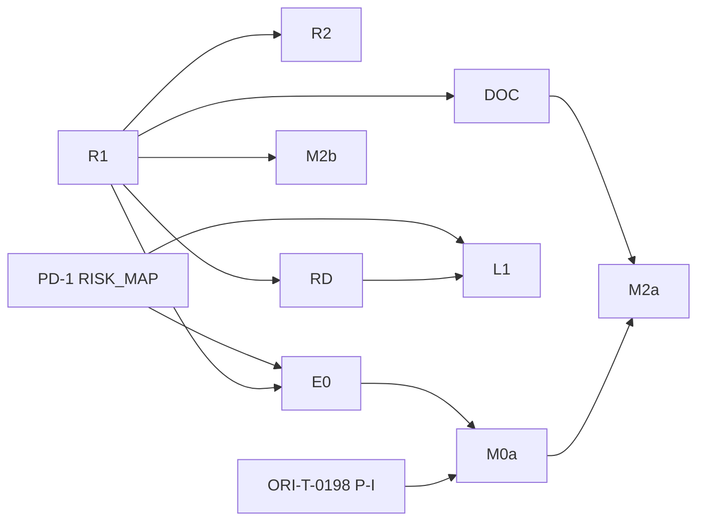

# Batch 12 plan (adopted): `ori-flows` (ORI-T-0060 to ORI-T-0065)

> **Status: adopted.** Written 2026-10-19 by the lead from `ops/batch-12-plan-draft.md` (planner at `2ab7e63`), `ops/batch-12-plan-review.md` (four reviewers at `ecdcfab`), and **The lead's calls on the batch 12 review** in `ops/handoff/README.md`, which override the draft where they differ. Base commit for citations: **`f3d624b`** on `claude/sweet-maxwell-jkaiie` (271 commits ahead of `main` at `7bed207`; `7bed207` never touched `crates/ori-flows`).

This is the before-each-batch control point of `ops/phase-1-backlog.md` (:38-48). Every load-bearing claim below was checked against the tree at `f3d624b` unless marked as a lead reading.

## Preconditions at HEAD (`f3d624b`)

| Precondition | At HEAD | Evidence | On `origin/main` |
|---|---|---|---|
| Batch 2, `ori-core` | present | `crates/ori-core/src/{types,error,ticket,document,phase,permission}.rs` | yes |
| Batch 3, `ori-store` | present | `db.rs`, `event_log.rs`, `projections/`, `rebuild.rs` | yes |
| Batch 6, `ori-memory` | present | ten modules; `freshness.rs` (`is_ready` :759), `drift.rs` (`run` :592), `citation.rs`, `barrier.rs` (`sanitize_text` :1896) | **`drift.rs`, `citation.rs`, `oplog.rs`, `retrieval.rs` absent**; **`sanitize_text` absent** |
| Batch 7, `ori-gates` | narrowed | Batch 12 uses `prover.rs`, `liveness.rs`, significance restatement only. **ORI-T-0047 and ORI-T-0048 are not preconditions** of any slice | `prover.rs`, `liveness.rs` not on main |
| Batch 8, `ori-orchestrator` | present | `lifecycle.rs`, `lock_table.rs`, `escalation.rs`, `budgets.rs`, `closing.rs`, `merge_queue.rs` | yes |
| `templates/` (ORI-T-0009) | present | `templates/README.md:66`: foundation/phase templates not written by batch 9 | yes |
| `fixtures/new-product` | present | 1 tracked file (`README.md`); empty directory by design | no |
| `fixtures/migrated-with-drift` | present | 21 files (claim 73 integrated) | no |
| `fixtures/inert-gate`, `looping-agent` | present at HEAD | all four product fixtures exist at HEAD; **none on main** (PD-2) | no |
| `ori-mcp` S5 / registry | present | `host/registry.rs`, `ports.rs` | no |
| `serde` / `serde_json` | approved | `ops/escalations/E-0008-json-serialization.md:32` | — |
| ORI-T-0060 (registry) | **absent** | `crates/ori-flows/src` = `lib.rs` only; `git log -- crates/ori-flows` → **`ecbb71c` only** | — |
| ORI-T-0055 | absent | waits ORI-T-0163 (claim 112) | — |
| Lock-table claims | 20, 112, 117, 121 | ORI-T-0194 on 121; **ORI-T-0195**, **ORI-T-0196** allocated on PR 78 (repair 2 follow-ups, not yet in lock table); **next free ORI-T-0197** (R1, this adoption) | — |

**Fold precedents from ORI-T-0194 (integrated):** two-pass payload read (`serde_json::Value` shape, then `deny_unknown_fields` struct); write with `serde_json::to_string`, never `json!`; first refused fold event **locks** the product until a human changes the fold (`ops/lock-table.md:2635-2654`, R45 point 3).

---

## Decisions (adopted)

| # | Decision | Notes |
|---|---|---|
| D1 | **One registry, one fold, one writer** in `registry.rs` (widens backlog `init.rs`). **`registry::record`** is the only in-crate appender of `document.*`. **`registry::create_product`** is the only appender of `product.created`. The **fold is the control**: it re-checks every rule for every event whoever appended it (human actor on `document.approved` and `document.changes_requested`; seat holder from folded `product.created`; `Document::apply`; `fires_from`; registration rules). **Lockout:** at the first event the fold refuses, `DocumentRegistry::read` errors with that seq/defect; readiness, launch and every `registry::record` refuse for that product (**operator question Q11**, same trade as ORI-T-0194 / R45 point 3). | |
| D2 | **Payloads fixed now** only for kinds batch 12 appends. **`document.submitted`** and **`document.drifted`** are named but **not fixed** until Q7 and P-F respectively; the fold **refuses** those kinds until then. **`product.created`:** `{name, repo_path, repo_remote?, aicd_version, origin, seats:[{seat, holder}], documents:[{id, kind, path, set}]}` — **no `owner` in payloads** (D12). **`document.registered`:** `{document_id, kind, path, set}`. **`document.created` / `document.revised`:** `{document_id, pr, content_len, citations_unresolved}` (all required; `pr` validated, no userinfo secrets). **`document.changes_requested`:** `{document_id, instructions}`; **human actor only**; non-blank, control chars refused, capped (8192 bytes, same order of magnitude as barrier caps). **`document.approved`:** `{document_id, seat}`. **Before append:** refuse `repo_remote` with password userinfo (`https://user:pass@`, `http(s)://<anything>@` with password); accept scp-style and password-free forms; **`repo_path` canonical absolute**; fold refuses bad `product.created`. **Two-pass read / `to_string` write** as ORI-T-0194. Agent free text: never raw; `mcp.*` none; other events only `barrier::sanitize_text` output where allowed (`escalation.raised` precedent). | Blocking remote credential fix adopted |
| D3 | **New kinds named** with payload rules: `launch.refused` (items + reasons from readiness), `launch.failed`, `launch.completed`; `migration.*` (incl. `migration.m2_started {m1: "not_delivered"}` when Q2 needs it); `divergence.filed` / `divergence.resolved` (sanitized/capped agent text; human-only resolve). **`migration.*` is independent of Q3**; `phase.*` reserved for Phase entity. PD-2 documents kinds. | |
| D4 | **Edges:** add `ori-flows → ori-core`, pinned `serde`/`serde_json` (`serde` with **`derive`** for payload structs, `=1.0.229` / `=1.0.151`). Add **`ori-flows → ori-memory`** for **in-memory entry points only** — never `Corpus::read_specification`, `read_files`, `SectionIndex::from_repository`, or Indexer/CodeMap file readers; engine supplies bytes (D6). **No** broker, runtime, watch, mcp, integrations, **ori-gates** (launch uses `Gates` port; proving stays in ori-gates — **not** CLAUDE.md:32). | |
| D5 | **`ports.rs` (R1):** `IdSource`, **`Clock`**, **`PortError`** with `Refused`, **`Denied { code, methodology_ref }`**, `Invalid`, `Unavailable` — same shapes as `ori_mcp::ports.rs` (:235, :400, :163-170). Module traits stay in slice modules. L2 uses shared `Clock`, not its own. | |
| D6 | **Working tree:** init/M0 **read only through engine ports**. **`RepositoryView`:** P-G (`ori-runtime`) owns `.git` operations (refs, tags, index `ls-files` without `--others`, history, blobs); P-W (`ori-watch`) owns working-tree bytes and ignore evaluation in-process from `.gitignore` files (no git spawn from watch). Init may `fs::create_dir` skeleton dirs only, never `create_dir_all`. **No lead ruling narrows CLAUDE.md:32.** | P-W/P-G split adopted |
| D7 | **Readiness:** pure `readiness::compute`; **`StaleReport::is_ready` only** (lock-table:344). Foundation: `disables_launch`; phase set: `document_set_approved`. L-01 evidence fail-closed. **Coverage:** readiness-inputs port returns corpus file set; each registered doc past Missing missing from corpus and not in `freshness_unknown` → not ready (`FreshnessNotChecked` per path). **Non-document missing entries:** seat from document that states the condition (reading; folded into Q6). **Phase set:** until registered, readiness never true by construction (Q4). | |
| D8 | **ORI-T-0062 → L1 only in batch 12.** L2 **leaves** the batch (backlog:21 / AICD §39). Step order: (1) human actor; (2) already launched; (3) readiness via **readiness-inputs port only** — refusal at 1–3 → exactly one `launch.refused`; other launch ports panic in L1 tests. After step 3 passes, abort → `launch.failed`. Refuses `origin: migrated`. **No** spurious `security` escalation. Decisional seeded ticket stops before Validated (**AICD §11**, not LLD:74). Forbidden attempt allowed → `launch.failed {step:"forbidden_action"}`. **ORI-P1-004** reassigned in backlog to first post-0070 ticket with real launch ports (lead). **Fake-port clause rule:** clauses only proven by fakes use `ori_t_<ticket>_*`, not criterion names. | L2 deferred |
| D9 | **ORI-T-0063 narrowed:** `approve`, `request_changes` (returns same id in Draft; new content via `propose`), `propose` only entry for `spec.write` + `SpecDesk::propose`. **`submit` only if Q7 yes.** **`flows.documents.generate` → method not found** in phase 1 (batch 10 D2 precedent). Backlog anchor corrected to API_SPEC §1 methods. ORI-P1-016: **`ori_t_0063_*`** for PR-opened clause; `ori_p1_016_*` for citation + Draft only. | |
| D10 | **E0, M0a, M0b split.** **E0 tier 2**, raised at claim (like ORI-T-0194); **PD-1 unconditional** for `migrate/env.rs`. Payload types owned in `env.rs`; append opaque from M0a. Secret scan **`unknown`**, reason **`not_run: no scanner decided for M-04`** (Q14). **Fixture `.env`:** tests pass bytes via sealed `EnvBytes` through fake `RepositoryView`, marker check per fixture README — no coder opens/greps `.env`. Archives listed, contents **`unknown: not opened`** (Q15). Workflow YAML: live / inert / **unreadable** (R27). | Operator: Q14–Q16 |
| D11 | **M2a / M2b split.** **M2b in `migrate/divergence.rs`** (depends R1 only). **M2a waits Q2 and Q3.** No `document.created` from M2; admission inside **`documents::propose`** via `pub(crate) Admission` from `m2::admit`. **`Availability` not hard-coded** — engine passes set from Q1 answer. Slot rules per AS_BUILT_SEQUENCE (slot 10 from divergence fold, not propose). | |
| D12 | **Owner seat never in event payloads.** **`FOUNDATION` + `AS_BUILT_SEQUENCE` code tables** map kind → `Seat` (interim reading: §9 owner where named, else first §23 verifier; register row 10 architect). Fold derives owner for `Document::apply`. **Q9** for SECURITY_NOTES, ROADMAP, as-built row 13 joint verification. | |
| D13 | **`registry::record` refuses** non-human on `document.approved` / `document.changes_requested`; **refuses approver not holding seat** in folded `product.created` seats (AICD §18). **`create_product` validates** four seats exactly once each, holders human. **Removed:** engine fills seats. Init requires client `seats` (0071 supplies for CLI). Migrated products: no seats in phase 1 → no as-built approval (consistent Q1/Q2). | Blocking fix |
| D14 | **Init (R2):** dirs only (`spec/`, `spec/adr/`, `spec/agents/`, `ops/`). Human actor only. Non-empty (except `.git`) → refuse §24 → `products.import`. **`repo_path` must exist, be directory, not symlink.** Returns **`ProductDb` + seq** for engine writer task. **`aicd_version` from engine bundle**, not RPC. Partial failure: **`remove_dir` only** on empty dirs created this call; orphan app-data dir left, path in error. **Q17:** ROADMAP:14 "identities" vs launch-only identities. | |
| D15 | **Queue files:** `Cargo.toml`, `lib.rs`, `Cargo.lock`, **`migrate/mod.rs` stub created in R1`**, `migrate/mod.rs` for E0/M0/M2. Lead integrates queue edits serially. | |

### FOUNDATION rows (fixed paths, `product.created`)

Lead reading of this repository's `spec/` layout (each path immutable in events):

| kind | path |
|---|---|
| brief | `spec/PROJECT_BRIEF.md` |
| architecture | `spec/ARCHITECTURE.md` |
| adr | `spec/adr/ADR-0001-stack.md` |
| data_model | `spec/DATA_MODEL.md` |
| security_notes | `spec/SECURITY_NOTES.md` |
| env_setup | `spec/ENV_SETUP.md` (permission manifest included; no separate `permissions` row) |
| conventions | `spec/CONVENTIONS.md` |
| observability | `spec/OBSERVABILITY.md` |
| ci_cd | `spec/CI_CD.md` |
| roadmap | `spec/ROADMAP.md` |
| agent_instructions | `spec/agents/CLAUDE.md` (shared base; role files via `document.registered` later) |

---

## Slices

| Slice | Ticket / backlog | Declared scope | Tier | Order |
|---|---|---|---|---|
| **R1** | ORI-T-0197 | `registry.rs`, `ports.rs`, `migrate/mod.rs` (stub), `tests/ori_t_0060_registry.rs`; queue: `Cargo.toml`, `lib.rs`, `Cargo.lock` | **1** | First |
| **R2** | 0060 | `init.rs`, tree-probe port, `tests/ori_p1_001_init.rs` | 1 | After R1 |
| **RD** | 0061 | `readiness.rs`, unit tests in module | 1 | After R1 |
| **DOC** | 0063 | `documents.rs`, `tests/ori_p1_040_*`, `tests/ori_p1_016_*` | 1 | After R1; no `submit` until Q7; propose refuses non Missing/Draft per Q8(c) |
| **E0** | 0064 | `migrate/env.rs`, unit tests in module | **2** (raised) | After **PD-1 env row** (unconditional); parallel with R1 |
| **M0a** | 0064 | `migrate/m0.rs`, `workflow.rs`, `inventory.rs`, `tests/ori_p1_024_*` | 1 | After E0; needs **ORI-T-0198** (P-I / migrated `create_product`) |
| **M0b** | 0064 | detection clause in `m0.rs` | 1 | Blocked: ORI-T-0055, ORI-T-0070 |
| **L1** | 0062 | `launch.rs` refusal path, `tests/ori_p1_003_*` | **2** (raised) | After RD, R1; PD-1 launch row |
| **L2** | 0062 | success sequence | **2** | **Not in batch 12** — after ORI-T-0029, Q4, Q5 |
| **M2a** | 0065 | `migrate/m2.rs` sequence/seed/admit | 1 | After R1, DOC; **blocked Q2, Q3** |
| **M2b** | 0065 | `migrate/divergence.rs`, register + tests | 1 | After R1 (not blocked on M2a file split) |

**Parallel after R1:** R2, RD, DOC, E0 (after PD-1 for E0/L1 tier), M2b — disjoint files; queue serialized.

**What can start (handoff):** **R1 now.** After R1: **R2, RD, DOC** (without `submit`; `spec.write` only Missing/Draft under Q8c), **E0**, **M2b**. **L1** after RD + R1. **M0a** after **ORI-T-0198** + E0. **L2, M2a, M0b wait** (Q4/Q5, Q2/Q3, ORI-T-0055/0070).

---

## Crate edges

| Edge | Action |
|---|---|
| `ori-store`, `ori-orchestrator` | keep |
| `ori-core`, `serde`, `serde_json`, `ori-memory` | add per D4/D5 (first memory edge in RD, DOC, or M2b) |
| broker, runtime, watch, mcp, integrations, gates | do not add |

---

## Prerequisites (selected)

| Id | Work | Tier | Notes |
|---|---|---|---|
| **PD-1** | **`adr_area` (Q12):** tier 2 rows for `launch.rs`, `migrate/env.rs`; doc ticket updates RISK_MAP + SECURITY_NOTES + ADR-0002; coder restates `RISK_MAP_TIER_TWO`. **No abstract engine row** until ORI-T-0070 names a file. | 2 | Before L1, E0 merge semantics |
| **PD-2** | API kinds, LLD FLOWS→MEM, fixture sentences; serializes with ORI-T-0192 on API_SPEC | 1 | |
| **PD-3** | Follow Q6, Q7, **Q13** | 1 decisional | |
| **PD-4** | DATA_MODEL owner on Document?, Divergence, inventory/env home | 1 | Q3, Q9 |
| **P-I** | **ORI-T-0198:** migrated `create_product` / future `products.import`; `origin: migrated`, empty foundation docs, as-built via `document.registered` | 1 | Before M0a |
| **P-G / P-W** | Split per D6 | 1–2 | |
| **P-V** | ORI-T-0059 | **2** (backlog:254) | Operator host app (backlog:258) |
| **P-B, P-X, …** | unchanged from draft | | L2 deferred |

---

## Operator questions

> Decisions that depend on an answer **wait**. Each lists options and the lead's **recommendation**.

| # | Trigger | Question | Options | Recommendation |
|---|---|---|---|---|
| **Q1** | `spec_conflict` / escalation 9 | Phase 1 as-built count (rows 9, 11, 13, 14 vs assistant in phase 3) | (a) docs 1–8, 10, 12 only; 9/11/13/14 Missing + deferral; (b) all 14 with doc-agent deferral note; **(c) rows 9 & 14 human-only via `spec.write` without assistant** | **(a)** or **(c)**; with 9 deferred, register compares pre-existing docs to 1–8 (html:971) |
| **Q2** | `spec_conflict` | May M2 run before M1 (§24.2, DATA_MODEL:113)? | (a) phase 1 narrowing + **`migration.m2_started {m1:"not_delivered"}`** event; (b) defer M2 to phase 2 | **(a)**; permission matrix unenforced until tier-2 migration column exists (state in packages) |
| **Q3** | `spec_conflict` / `precondition_missing` | Drive Phase entity in phase 1? How is "M2 running" recorded for ORI-P1-025? | (a) **`migration.*` / `divergence.*` only**, no Phase entity; record M2 via event + API read (PD-3); (b) build PhaseControl in phase 1 | **(a)**; PhaseControl is L-04 **phase 2** (PRD:83, ROADMAP:26) |
| **Q4** | `spec_conflict` / `precondition_missing` | L-01 non-document producers + **phase-set registration** (D-04 deferred) | Producers: (a) allocate in/after 0070; (b) narrow L-01 to documents only. Phase set: (i) init registers phase-1 set Missing; (ii) PD-3 registration method; (iii) narrow L-01 phase condition | Producers **(a)**; phase set **(ii)** |
| **Q5** | `precondition_missing` | Launch with **layer 2 count zero** while escalation #1 open? | yes / no | **yes**, record in `launch.completed` and PR "not tested" |
| **Q6** | `contract_change` | Add **`owner`** to API_SPEC `missing` items (ORI-P1-002)? | yes via PD-3 / no | **yes** before ORI-T-0066/0067 schema gen |
| **Q7** | `contract_change` | Add **`flows.documents.submit`** → `document.submitted`? | yes / no | **yes** |
| **Q8** | `spec_conflict` | `spec.write` on Approved/Stale? | (a) tier-2 core edges + `test_modified`; (b) reword criterion; **(c) refuse unless Missing or Draft** | **(c)** interim; also blocks doc-agent propose on Approved/Stale until (a/b) |
| **Q9** | `spec_conflict` | Joint verification vs single owner for **SECURITY_NOTES, ROADMAP, as-built row 13** (PROJECT_BRIEF owner settled §9 html:430) | primary seat / seat set (tier-2 core) | **D12 interim** single derived seat until seat-set chosen |
| **Q10** | `security` | Do **shape/entropy classes** that imply provider prefixes violate "no values in output" (ORI-P1-024)? | closed enums only / allow prefix classes | **closed enums**; align ORI-T-0077 with fixture README if needed |
| **Q11** | methodology / tier-2 trade | **Document registry fold lockout** (same trade as ORI-T-0194 / R45.3)? Widen ORI-T-0164 recovery? | accept lockout / skip-and-report (name kinds) | **accept lockout**; widen ORI-T-0164 |
| **Q12** | `adr_area` | Confirm **PD-1 tier 2 rows** for `launch.rs` and `migrate/env.rs` + SECURITY_NOTES + ADR-0002 tables | yes / no | **yes** |
| **Q13** | `contract_change` | PD-3 API additions: **`flows.migration.divergences`**, **`divergence.resolve`**, **`flows.migration.start` result**, **`flows.migration.inventory`** (no secret values) | yes / defer | **yes** before RPC schema generation |
| **Q14** | `precondition_missing` / `new_dependency` | **M-04 secret scan** of migrated product tree/history (not E-0003 gate-7 alone) | runtime-spawn pinned tool / defer Unknown | Same tool family as E-0003 settlement; **spawned by ori-runtime**; no ad-hoc matcher in ori-flows |
| **Q15** | `new_dependency` | **Z-04 archive half:** open zip/tar/gz for env candidates? | list Unknown not opened / add decompression crate | **list Unknown** in phase 1; opening is **new_dependency** |
| **Q16** | `spec_conflict` / `security` | **ARCHITECTURE:129** "nothing else touches a credential" vs M-04 measuring product env bytes in sealed `EnvBytes` | product-file analysis OK / treat as credential touch | **product-file analysis OK**; document in ARCHITECTURE §9 via PD-2 |
| **Q17** | `spec_conflict` | **ROADMAP:14 "identities"** at init vs launch-only (L-03) | init creates none + reword ROADMAP / init creates seat holders only / create `identity.created` events | **init creates none**; **identities** = seat holders in `product.created` **or** reword ROADMAP via PD-2 after choice |

**Lead decisions (not operator):** ORI-P1-004 backlog reassignment (D8); tier **raise at claim** for E0, L1 (and L2 when scheduled); **registry tier 1** with PD-1 amending RISK_MAP:21 reason to include seat-holder check in `registry::record` (alternative: tier-2 `registry.rs` row — not taken unless operator asks via Q12).

---

## Conflicts resolved

C1–C12 from draft adopted with review fixes (owner in code table not payload; single writer; ports in R1; memory edge limited; L2 out; M2b file split; tier/PD-1; corrected line citations in packages).

---

## Recorded (non-blocking)

- Fixture drift split: **nine** agent-filed entries (README :78–87 less D-06) → **2/2/4/1/0** across overview/architecture/api/runbook/cli (**ten** total findings including D-06 mechanical).
- Gates **8, 9, 14** no runner; gate 7 secret third not installed (E-0003); G4 needs full `REQUIRED_GATES`.
- A-09 for **products** (methodology in repo per ARCHITECTURE:111/:123) not init's event-only version — ticket or reading owed.
- PD-2/PD-3 serialize with **ORI-T-0192** on `API_SPEC.md`.

---

## Fact-check (lead, `f3d624b`)

| Claim | Result |
|---|---|
| `ori-flows` only `ecbb71c` | **pass** |
| `7bed207` not in `git log -- crates/ori-flows` | **pass** |
| RISK_MAP:21 tier 1 whole crate | **pass** |
| `document.drifted` has `at: Timestamp` (document.rs:252-254) | **pass** |
| ori-mcp PortError + Clock + IdSource | **pass** |
| hooks.rs remote credential test :6199+ | **pass** |
| citation.rs reads working tree :1119+ | **pass** |
| ori-store serde without derive in manifest | **pass**; R1 adds derive on ori-flows dep |
| Claims / next id ORI-T-0197 after 0195/0196 | **pass** (0195/0196 on PR 78 comment) |
| P-V tier 2 backlog:254 | **pass** |
| SECURITY_NOTES:51 scope mcp.* only | **pass** |
| LLD:74 ≠ Decisional (AICD §11) | **pass** (D8 cites §11) |

Independent re-check: same results on paths sampled above; no blocking discrepancies.

---

## Identifier allocations (this adoption)

| Id | Purpose |
|---|---|
| ORI-T-0195 | ORI-T-0187 repair 2 (PR 78) |
| ORI-T-0196 | ORI-T-0163 repair 2 (PR 78) |
| **ORI-T-0197** | Batch 12 slice **R1** (this plan) |
| **ORI-T-0198** | **P-I** migrated product creation (`create_product` / import precursor) |
